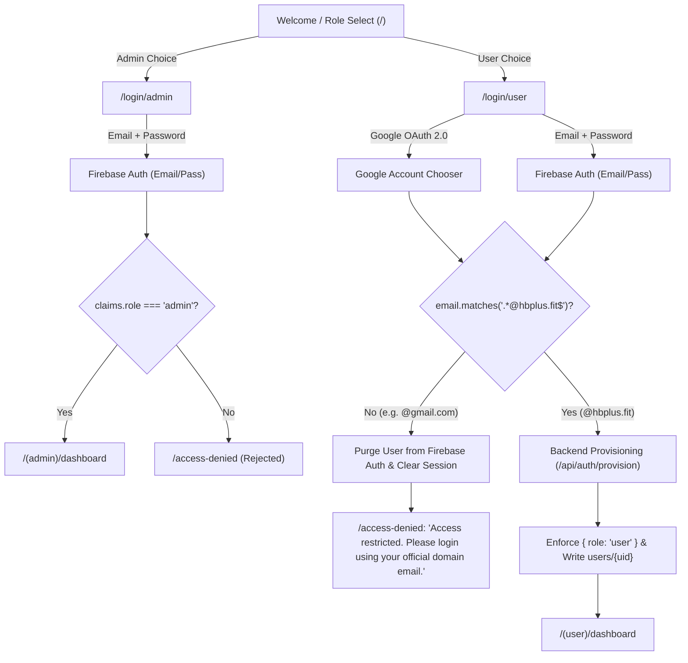

# HBPlus — Secure Role-Based Corporate Access Portal

An executive-grade, cross-platform enterprise portal built with **one unified codebase** for **Web (React Native for Web)**, **Android (Installable APK)**, and **iOS**.

HBPlus enforces a zero-trust, domain-governed security architecture: **only authenticated accounts ending strictly with `@hbplus.fit` are admitted**.

---

## 1. Architecture & Authentication Flow



### The Two Distinct Paths
1. **Admin Path (`/login/admin`)**:
   - **Email + Password only** (No Google OAuth button).
   - Requires email validation against `isAllowedEmail`.
   - Forces an ID token refresh and verifies cryptographic custom claim `claims.role === 'admin'`.
   - Non-admins are immediately signed out and redirected to `/access-denied`.
   - Admin accounts can **never be created publicly**; they are provisioned exclusively via the secure CLI tool `scripts/create-admin.js`.
2. **User Path (`/login/user`)**:
   - **Continue with Google (OAuth 2.0)** or User Email + Password.
   - Enforces immediate client-side and server-side domain verification.
   - External domains (`@gmail.com`) are immediately revoked, purged from Firebase Auth, and redirected to `/access-denied`.
   - Google sign-in can **never produce an admin role**.

---

## 2. Four Layers of Domain & Role Enforcement

Security is **never trusted to client-side checks alone**. The `@hbplus.fit` restriction is validated in 4 independent layers:

1. **Client-Side Pure Validator (`isAllowedEmail`)**:
   Instant feedback before network requests. Rejects non-ASCII, Unicode look-alikes, subdomains, quoted prefixes, or malicious suffixes.
   ```typescript
   export function isAllowedEmail(email: string, domain = 'hbplus.fit'): boolean {
     const e = email.trim().toLowerCase();
     if (/[^\x20-\x7E]/.test(e) || e.includes('"')) return false;
     const at = e.lastIndexOf('@');
     if (at < 1 || at !== e.indexOf('@')) return false;
     return e.slice(at + 1) === domain.toLowerCase();
   }
   ```
2. **Server Middleware & Deletion of Intruders**:
   On every API request, `authenticate` verifies the Firebase ID token cryptographically. If an unauthorized email slips through Google OAuth, the server calls `adminAuth.deleteUser(uid)` to delete the account immediately from Firebase Auth, preventing outsiders from polluting the project.
3. **Cloud Firestore Security Rules (`firestore.rules`)**:
   Rules enforce token claims and domain regex directly on the database engine:
   ```javascript
   function signedIn()   { return request.auth != null; }
   function inDomain()   { return signedIn()
                              && request.auth.token.email_verified == true
                              && request.auth.token.email.matches('.*@hbplus[.]fit$'); }
   function isAdmin()    { return inDomain() && request.auth.token.role == 'admin'; }
   function isOwner(uid) { return inDomain() && request.auth.uid == uid; }

   match /users/{uid} {
     allow read:   if isOwner(uid) || isAdmin();
     allow create: if false; // only Server provisions
     allow update: if isAdmin() || (isOwner(uid) && !('role' in request.resource.data.diff(resource.data).affectedKeys()));
     allow delete: if isAdmin();
   }
   match /auditLogs/{id} { allow read: if isAdmin(); allow write: if false; }
   match /{document=**}  { allow read, write: if false; }
   ```
4. **AuthGate Route Protection (`RootNavigator.jsx`)**:
   Prevents unauthenticated URL navigation. Redirects unauthorized users to `/` and prevents role escalation.

---

## 3. Brand Tokens & Hexagonal Honeycomb Mark

- **Palette ("Midnight, Emerald & Amber")**:
  - `primary`: `#00B386` (Emerald) / dark `#2EE6B6`
  - `primaryDeep`: `#00775B`
  - `primarySoft`: `#E0F8F1` / dark `#0E2B26`
  - `accent`: `#FFB020` (Amber) / dark `#FFC857`
  - `bg`: `#F4F8F7` / dark `#06100E`
  - `surface`: `#FFFFFF` / dark `#0D1B18`
- **Hexagonal Honeycomb Tile**:
  - Precision rounded hexagon filled with brand gradient (`#00D9A5` -> `#00B386` -> `#0A84FF`).
  - Integrated geometric **H** and **B** glyphs sharing the central vertical stem.
  - Overlapping **amber `+`** badge with 180° spin entrance and 6-second pulse.

---

## 4. Quick Start & Setup Instructions

### Prerequisites
- Node.js 18+ (Node 20+ recommended)
- Java 17 or 21 (for Android APK Gradle builds)
- Android SDK configured (`ANDROID_HOME`)

### Installation
```bash
git clone https://github.com/vishalkhadatare/rivalry.git
cd rivalry
npm install
```

### Running Locally
```bash
# 1. Start Express Backend API (Port 5000)
npm run dev:server

# 2. Start Vite Web Client (Port 8081)
npm run dev:client
```
Open [http://localhost:8081](http://localhost:8081) in your browser.

---

## 5. Provisioning the First Admin Account

Admin accounts cannot be registered publicly. To provision an administrator, run the secure CLI script:

```bash
ADMIN_EMAIL="admin@hbplus.fit" ADMIN_PASSWORD="YourSecurePassword123!" node scripts/create-admin.js
```
The script:
1. Validates the email against `@hbplus.fit`.
2. Creates the user in Firebase Auth.
3. Sets the custom claim `{ role: 'admin' }`.
4. Writes the document to `users/{uid}` in Cloud Firestore.
5. Logs the action to `auditLogs`.

---

## 6. Building the Android APK

To generate the standalone Android APK locally:

```bash
# Windows
build-apk.bat

# Or via npm
npm run build:client
cd apps/client/android && gradlew.bat assembleDebug
```
The compiled deliverable is saved at:
`D:\Rivarly\HBPlus-Access.apk` (~4.6 MB).

---

## 7. Running Unit & Integration Tests

```bash
npm test
```
Runs:
- Domain validator unit tests (testing official domains, Gmail rejection, prefix/suffix attacks, Unicode look-alikes).
- RBAC authorization middleware tests.
- Design tokens & responsive breakpoint layout tests.

---

## 8. License & Attributions
- Icons: Vector SVG icons derived from Lucide & Phosphor. See [ATTRIBUTIONS.md](file:///d:/Rivarly/ATTRIBUTIONS.md).
- License: MIT.
