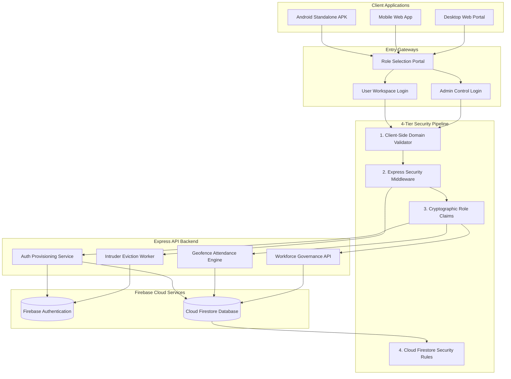
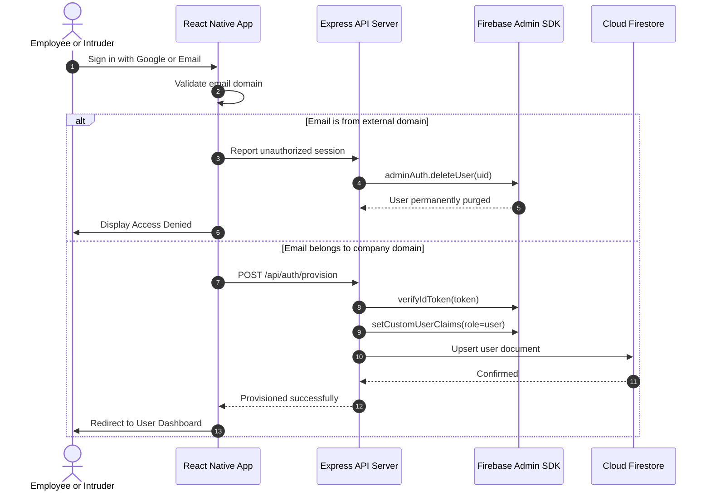

<div align="center">

# ⬢ HB Plus (HB+)
### Enterprise-Grade Cross-Platform Workforce & Secure Access Portal

[](https://necolas.github.io/react-native-web/)
[](https://developer.android.com/)
[](https://firebase.google.com/)
[](https://nodejs.org/)
[](https://vitejs.dev/)
[](https://jestjs.io/)
[](https://opensource.org/licenses/MIT)

<p align="center">
  <b>A unified, zero-trust workforce governance portal engineered for Android, Web, and Desktop.</b><br/>
  Featuring dual-persona design language, strict <code>@hbplus.fit</code> domain isolation, 1-tap geofenced attendance, and instant vector flag selectors.
</p>

[Key Features](#-key-features) • [System Architecture](#-system-architecture) • [Colourful Technology Stack](#-colourful-technology-stack) • [Security & Domain Governance](#-security--domain-governance) • [Quick Start](#-quick-start) • [Building Android APK](#-building-the-android-apk)

---

</div>

## 🌟 Key Features

<table>
  <tr>
    <td width="50%">
      <h3>🏢 Dual-Persona Experience</h3>
      <ul>
        <li><b>User Workspace:</b> Calming teal-to-emerald gradient theme (<code>#0F766E → #14B8A6</code>), shift countdowns, 1-tap geofenced attendance check-in, leave balances, and net salary slips.</li>
        <li><b>Admin Control Room:</b> Warm coral-orange theme (<code>#C2410C → #F97316</code>), real-time attendance trends (30-day analytics), headcount SLA, approval queues, and live audit logging.</li>
      </ul>
    </td>
    <td width="50%">
      <h3>🛡️ Zero-Trust Domain Enforcement</h3>
      <ul>
        <li><b>Strict <code>@hbplus.fit</code> Domain Gate:</b> 4-tier security validation across client validators, Express API middleware, Cloud Firestore database rules, and router navigation guards.</li>
        <li><b>Automated Intruder Eviction:</b> Rogue accounts (such as unauthorized <code>@gmail.com</code> logins via OAuth) are purged instantly via Firebase Admin SDK.</li>
      </ul>
    </td>
  </tr>
  <tr>
    <td width="50%">
      <h3>🌍 Global Mobile Number Suite</h3>
      <ul>
        <li><b>Fast SVG Vector Flags:</b> Integrated country picker supporting 50+ countries with instant search, crisp rendering, and zero bitmap blur across all screen densities.</li>
        <li><b>Overflow-Safe Layout:</b> Dynamic flex system that prevents mobile number truncation on Android devices of any width.</li>
      </ul>
    </td>
    <td width="50%">
      <h3>⚡ Plain Data-Entry System</h3>
      <ul>
        <li><b>Seamless Input Focus:</b> Eliminated floating modal boxes and nested component remounts for fluid, distraction-free text entry.</li>
        <li><b>Cross-Platform Parity:</b> Identical touch feel, animations, and typography across mobile web and native Android APK.</li>
      </ul>
    </td>
  </tr>
</table>

---

## 🎨 Colourful Technology Stack

<div align="center">

### Frontend & Mobile Engine
| Technology | Badge | Role in HB Plus |
| :--- | :--- | :--- |
| **React Native for Web** |  | Unified component hierarchy across Web and Android |
| **React 18** |  | Core view layer and state management |
| **Vite 6** |  | Ultra-fast client bundler and HMR dev server |
| **Capacitor 7** |  | Native Android bridge and container runtime |
| **Android SDK & Gradle** |  | Native APK compilation with Java 21 toolchain |
| **Lucide Icons** |  | Lightweight, consistent 2px stroke icon system |

<br/>

### Backend & Cloud Infrastructure
| Technology | Badge | Role in HB Plus |
| :--- | :--- | :--- |
| **Node.js 20+** |  | High-performance asynchronous JavaScript runtime |
| **Express.js** |  | RESTful API server with custom security middleware |
| **Firebase Auth** |  | Google OAuth 2.0 & Email/Password authentication |
| **Cloud Firestore** |  | Real-time NoSQL database governed by security rules |
| **Firebase Admin SDK** |  | Privileged user management and custom claims assignment |

<br/>

### Quality Assurance & Tooling
| Technology | Badge | Role in HB Plus |
| :--- | :--- | :--- |
| **Jest** |  | Comprehensive unit & integration testing suite (48 tests) |
| **Babel** |  | ESNext and JSX transpilation |
| **PowerShell / Bash** |  | 1-click APK compilation & build automation scripts |

</div>

---

## 🏗️ System Architecture

HB Plus utilizes a tiered architecture where security boundaries are strictly enforced across transport, identity, and persistence layers:

```
┌────────────────────────────────────────────────────────────────────────────────────────┐
│                              HB PLUS SYSTEM ARCHITECTURE                               │
├────────────────────────────────────────────────────────────────────────────────────────┤
│  📱 CLIENT PLATFORMS (Unified React Native Codebase)                                   │
│  ├── Android Standalone APK (Capacitor 7 + Java 21)                                    │
│  ├── Mobile Web App (Responsive Web Touch Engine)                                      │
│  └── Desktop Web Portal (Split-Screen Executive Interface)                             │
├────────────────────────────────────────────────────────────────────────────────────────┤
│  🧭 ACCESS GATEWAY & ROLE ROUTING                                                      │
│  ├── Role Selection (/) ──────────────────────────────────────┐                         │
│  │   ├── User Workspace (/login/user) ────────────────────────┼─► 4-Tier Security Gate │
│  │   └── Admin Control (/login/admin) ────────────────────────┘                        │
├────────────────────────────────────────────────────────────────────────────────────────┤
│  🛡️ 4-TIER SECURITY & DOMAIN FIREWALL                                                 │
│  ├── Tier 1: Client-Side Pure Validator (isAllowedEmail)                               │
│  ├── Tier 2: Express Security Middleware (ID Token & Domain Signature Check)            │
│  ├── Tier 3: Cryptographic Role Claims ({ role: 'admin' | 'user' })                    │
│  └── Tier 4: Cloud Firestore Security Rules (Direct DB Engine Guard)                   │
├────────────────────────────────────────────────────────────────────────────────────────┤
│  ⚙️ NODE.JS / EXPRESS BACKEND (Port 5000)                                              │
│  ├── /api/auth/provision       ──► Validates Domain & Assigns Cryptographic Claims     │
│  ├── /api/attendance/checkin   ──► Geofence Radius & Live Timestamp Audit              │
│  ├── /api/admin/workforce      ──► Workforce Analytics, Trends & Approvals             │
│  └── Intruder Eviction Worker  ──► Auto-purges unauthorized accounts via Admin SDK     │
├────────────────────────────────────────────────────────────────────────────────────────┤
│  ☁️ CLOUD INFRASTRUCTURE & PERSISTENCE                                                 │
│  ├── Firebase Auth Engine (OAuth 2.0 & JWT ID Tokens)                                  │
│  └── Cloud Firestore (users/{uid} | auditLogs/{id})                                    │
└────────────────────────────────────────────────────────────────────────────────────────┘
```

### Interactive Flow Diagram



---

## 🔒 Security & Domain Governance

Security in HB Plus is non-negotiable. Domain restrictions are never delegated solely to client-side checks.

```
┌────────────────────────────────────────────────────────────────────────────────────────┐
│                     ZERO-TRUST DOMAIN ENFORCEMENT PIPELINE                             │
├────────────────────────────────────────────────────────────────────────────────────────┤
│                                                                                        │
│   [ Employee or Intruder ]                                                             │
│              │                                                                         │
│              ▼                                                                         │
│   [ Step 1: Client Entry ] ──► Enter credentials / Google OAuth                        │
│              │                                                                         │
│              ▼                                                                         │
│   [ Step 2: Domain Check ] ──► isAllowedEmail(email, "hbplus.fit")                     │
│              │                                                                         │
│              ├───────────────────────────────────┐                                     │
│              │ (FAILED: e.g. @gmail.com)         │ (PASSED: @hbplus.fit)               │
│              ▼                                   ▼                                     │
│   [ Intruder Detected! ]              [ POST /api/auth/provision ]                     │
│              │                                   │                                     │
│              ▼                                   ▼                                     │
│   [ adminAuth.deleteUser(uid) ]       [ Cryptographic Role Claim ]                     │
│   Account permanently destroyed       Custom claim { role: 'user' } set                │
│              │                                   │                                     │
│              ▼                                   ▼                                     │
│   [ Access Denied View ]              [ Access Granted: User Dashboard ]               │
│                                                                                        │
└────────────────────────────────────────────────────────────────────────────────────────┘
```

### Authentication Sequence Flow



### The 4 Security Layers:
1. **Client Pure Validator (`isAllowedEmail`)**: Rejects non-ASCII characters, Unicode homoglyphs, subdomains, quoted prefixes, and external domains before requests leave the client.
2. **Server Middleware**: Cryptographically verifies the Firebase ID token signature and claims. Non-conforming accounts are immediately purged via `adminAuth.deleteUser(uid)`.
3. **Database Rules (`firestore.rules`)**: Granular security rules require `request.auth.token.email.matches('.*@hbplus[.]fit$')` and prevent privilege escalation.
4. **AuthGate Route Guard (`RootNavigator.jsx`)**: Enforces authentication state and prevents unauthorized cross-role view transitions.

---

## 📱 Design System & Colour Palette

| Persona | Primary Gradient | Background | Surface | Accent |
| :--- | :--- | :--- | :--- | :--- |
| **User Workspace** | `#0F766E` → `#14B8A6` (Teal-Emerald) | `#F0FDFA` (Soft Mint) | `#FFFFFF` (Pure White) | `#10B981` (Success Green) |
| **Admin Control** | `#C2410C` → `#F97316` (Warm Coral-Orange) | `#FFF7ED` (Cream-Peach) | `#FFFFFF` (Pure White) | `#FF7A1A` (Vibrant Amber) |
| **Dark Accents** | `#0F172A` (Slate 900) | `#1E293B` (Slate 800) | `#334155` (Slate 700) | `#64748B` (Slate 500) |

- **Typography:** Inter / Plus Jakarta Sans with refined optical hierarchy and letter tracking.
- **Micro-Interactions:** 200ms spring animations, gentle input focus rings with 14px radius, and haptic-feel feedback.
- **Country Flags:** Crisp vector SVGs with 3-character ISO and dialing code search.

---

## 🚀 Quick Start

### Prerequisites
- **Node.js** 18+ (Node 20+ LTS recommended)
- **Java 17 or 21** (Required for Android APK Gradle compilation)
- **Android SDK** configured with `ANDROID_HOME` in environment variables

### 1. Clone & Install Dependencies
```bash
git clone https://github.com/vishalkhadatare/rivalry.git
cd rivalry
npm install
```

### 2. Configure Environment Variables
Create `.env` inside `apps/server/` and `apps/client/`:
```env
# Server (.env)
PORT=5000
ALLOWED_DOMAIN=hbplus.fit
FIREBASE_SERVICE_ACCOUNT_PATH=./serviceAccountKey.json

# Client (.env)
VITE_API_URL=http://localhost:5000
VITE_FIREBASE_API_KEY=your_api_key
VITE_FIREBASE_AUTH_DOMAIN=your_project.firebaseapp.com
VITE_FIREBASE_PROJECT_ID=your_project_id
```

### 3. Launch Development Servers
```bash
# Terminal 1: Start Express API Backend (Port 5000)
npm run dev:server

# Terminal 2: Start Vite Client (Port 8081)
npm run dev:client
```
Visit **[http://localhost:8081](http://localhost:8081)** to preview in your browser.

---

## 🛠️ Provisioning Administrator Accounts

Admin accounts cannot be self-registered through the public UI. Use the secure CLI provisioning tool:

```bash
ADMIN_EMAIL="admin@hbplus.fit" ADMIN_PASSWORD="SecurePassword123!" node scripts/create-admin.js
```
The script:
1. Validates the email against the strict `@hbplus.fit` domain policy.
2. Creates the administrator in Firebase Authentication.
3. Cryptographically attaches the `{ role: 'admin' }` custom claim.
4. Initializes the `users/{uid}` record in Cloud Firestore.
5. Emits an immutable log in `auditLogs/{id}`.

---

## 📦 Building the Android APK

HB Plus features a zero-dependency build automation script that builds client production assets, syncs Capacitor plugins, and triggers the Gradle toolchain:

```bash
# Windows
.\build-apk.bat

# Or via npm scripts
npm run build:client
cd apps/client/android && gradlew.bat assembleDebug
```

The completed, installable deliverable is output to:
```
D:\Rivarly\HBPlus-Access.apk (~4.6 MB)
```

---

## 🧪 Running the Test Suite

Execute the full automated test suite covering domain validation, RBAC middleware, responsive tokens, and flag mappings:

```bash
npm test
```

```text
PASS apps/server/tests/authorization.test.js
PASS apps/server/tests/authRoutes.test.js
PASS apps/server/tests/domainValidator.test.js
PASS apps/client/tests/responsiveAndTokens.test.js
PASS apps/client/tests/countryFlags.test.js
PASS apps/client/tests/domainValidator.test.js

Test Suites: 6 passed, 6 total
Tests:       48 passed, 48 total
Snapshots:   0 total
Time:        3.15 s
```

---

## 📄 License & Attributions
- **License:** Licensed under the [MIT License](LICENSE).
- **Icons & Assets:** Vector graphics and SVG iconography adapted from Lucide & Phosphor under MIT. See [ATTRIBUTIONS.md](ATTRIBUTIONS.md).

<div align="center">
  <sub>Engineered with precision for executive enterprise operations. © HB Plus.</sub>
</div>